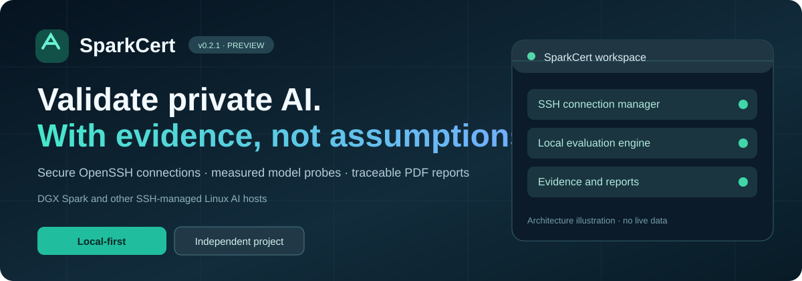
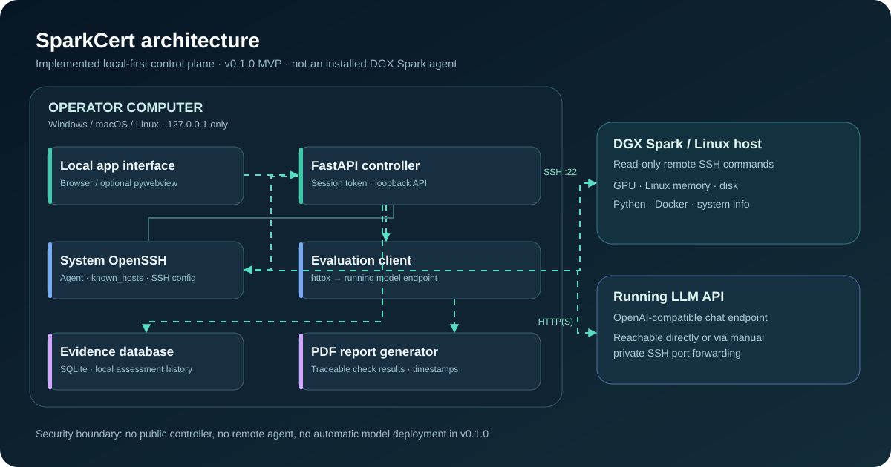
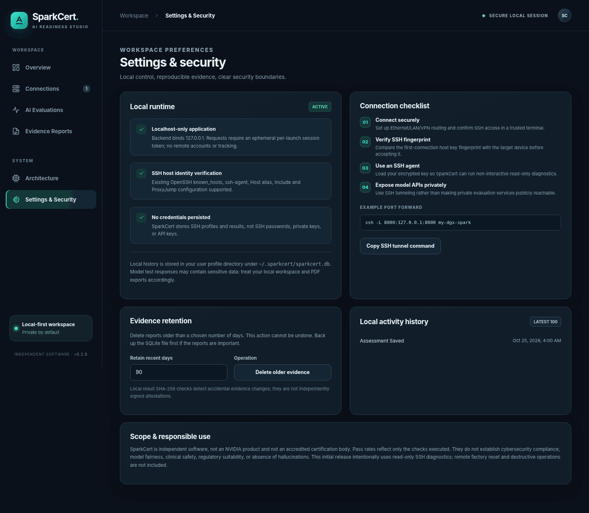
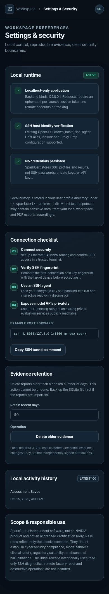

<div align="center">



# SparkCert

**Local-first AI production-readiness assessment for NVIDIA DGX Spark and SSH-managed Linux inference hosts.**

*Connect securely. Inspect real infrastructure. Evaluate a running model API. Export traceable evidence.*

**Development candidate v0.2.0** · **Windows / macOS / Linux source install** · **No cloud account required** · **Independent, unofficial project**

[Quick start](#quick-start-source) · [Animated walkthrough](#animated-product-walkthrough) · [Architecture](#system-architecture) · [Current features](#what-actually-works-in-v020) · [Roadmap](docs/PRODUCT_ROADMAP.md) · [Continue development](docs/HANDOVER_START_HERE.md)

</div>

> [!IMPORTANT]
> **Development MVP, not a certified production release.** SparkCert is independently developed, is not affiliated with or endorsed by NVIDIA, and does **not** issue NVIDIA-approved or regulatory certificates. Readiness percentages apply only to explicitly executed checks. No physical DGX Spark / cross-platform installer validation is claimed.

## Animated product walkthrough

<p align="center">
  
</p>

**Four-step workflow:** **Connect** through system OpenSSH (including familiar VS Code-style aliases) → **Inspect** read-only Linux/GPU diagnostics → **Evaluate** a separately running OpenAI-compatible model endpoint → **Report** results with local history and PDF export.

*This animation is a conceptual walkthrough of the implemented workflow, not a live screen recording or evidence of successful DGX Spark hardware testing. It respects reduced-motion preferences.*

**Experience today:** source-installed local web UI or optional pywebview desktop window. Native signed Windows/macOS/Linux installers, automatic device discovery, remote agent installation, model deployment and accredited certification remain **planned, not shipped**. Private localhost-only SSH tunnels and bounded opt-in file transfers are implemented as development features but still await real-device validation.

## System architecture

<p align="center">
  
</p>

**What runs where:** SparkCert's UI, FastAPI controller, OpenSSH client, evaluator and SQLite database run **on the operator's computer**. The remote DGX Spark/Linux host is accessed through existing SSH for read-only diagnostics; optional bounded uploads go to a dedicated private folder after explicit user consent. AI model checks contact a **separately running** OpenAI-compatible endpoint, either directly or through a user-managed or SparkCert-managed localhost-only SSH tunnel. There is **no deployed SparkCert remote agent in v0.2.0**; all tunnel and file-transfer operations depend on an existing trusted SSH connection.

See the editable [Mermaid diagram and detailed data-flow documentation](docs/ARCHITECTURE.md), the [animated architecture tour](docs/ARCHITECTURE.html) (download/open locally; GitHub does not execute HTML previews), and the [design system](docs/DESIGN_SYSTEM.md).

## Why SparkCert?

Most AI deployment documentation stops at "the model runs." SparkCert focuses on the evidence needed to assess a real environment: authenticated connectivity, observable host prerequisites, repeatable model probes, explicit test limitations, and exported reports. This is **assessment tooling**, not a replacement for NVIDIA's official device-management software or an accredited certification program.

### Project navigation

| Resource | What it contains |
| --- | --- |
| [Architecture](docs/ARCHITECTURE.md) | Implemented components, trust boundaries, data flows and planned evolution |
| [Design system](docs/DESIGN_SYSTEM.md) | Typography, colors, layout, subtle animations, accessibility constraints |
| [Product status](docs/PROJECT_STATUS.md) | Implemented vs partial vs planned vs unverified features |
| [Verification ledger](docs/VERIFICATION.md) | Test evidence, manual hardware / OS validation matrix |
| [Development roadmap](docs/PRODUCT_ROADMAP.md) | Production hardening and milestones |
| [Workspace handover](docs/WORKSPACE_HANDOFF.md) | Canonical handoff for another computer or coding agent |
| [Installation & onboarding](docs/INSTALLATION.md) | Windows/macOS/Linux source install, Ethernet/SSH and private model tunnel setup |
| [Release qualification](docs/RELEASE_CHECKLIST.md) | Explicit verified checks, remaining hardware/signing/security gates |
| [Security and privacy model](docs/SECURITY_MODEL.md) | Trust boundaries, controls, residual risks and next security reviews |
| [Repository About metadata](docs/REPOSITORY_PROFILE.md) | Description, suggested GitHub topics and setup instructions |
| [Continue in new workspace](docs/CONTINUE_IN_NEW_WORKSPACE.md) | Reusable development prompt and continuity checklist |

---

## What actually works in v0.2.0

| Capability | Implementation | Notes |
| --- | --- | --- |
| Windows, macOS, Linux app | Browser-based local application | Runs anywhere with Python 3.11+ and OpenSSH installed |
| Optional native desktop window | pywebview launcher | Optional dependency; packaging workflow provided |
| Direct Ethernet, LAN, VPN access | Via system networking / OpenSSH | Network and SSH access must already be configured |
| SSH host profiles | Save connections locally | No passwords, tokens, private key contents stored |
| VS Code-compatible SSH config | Import `~/.ssh/config` Host aliases | OpenSSH handles `IdentityFile`, `Include`, `ProxyJump` and ssh-agent |
| Host key checking | Strict OpenSSH `known_hosts` | New host keys must be independently verified before use |
| Password authentication | Opens system terminal | No password form or password storage in this version |
| SSH terminal | Launches system terminal | Supports interactive ssh/key passphrase prompts |
| Device diagnostics | Real read-only SSH commands | GPU/driver, host RAM, disk, Docker, Python and system info |
| Remote file management | Home-scoped listing; opt-in upload/download | 16 MiB limit; remote Python 3 required; uploads uniquely named under `~/sparkcert-uploads` |\n| Managed private SSH tunnel | Loopback-only OpenSSH port forwarding | Up to four temporary tunnels; does not start or verify a model API |
| Infrastructure readiness | 7 measured checks | Not a compliance or safety certification |
| Live AI evaluation | OpenAI-compatible `/v1/chat/completions` | 4 built-in probes, custom cases, 1–3 repeats and 1–4 concurrent requests, measured p50/p95 |
| Readiness reports | SQLite history, evidence SHA-256 check, PDF export, retention controls and activity log | Digest is not signed attestation; data at rest is not encrypted |
| Offline/private deployments | Works without cloud credentials | Actual evaluation endpoint must be reachable |

## Quick start (source)

**Prerequisites:** Python 3.11+, OpenSSH client (`ssh`), a browser, and a reachable DGX Spark host for remote features. DGX OS initial setup and SSH account should already work.

```bash
# In the extracted project folder
python -m venv .venv
# Linux/macOS:
source .venv/bin/activate
# Windows PowerShell:
# .venv\\Scripts\\Activate.ps1
python -m pip install -e .
python -m sparkcert
```

The app opens on a random free **localhost-only** port (127.0.0.1). Closing the terminal stops the app. There is no user account, cloud dashboard, telemetry or analytics service.

### Optional native app window

```bash
python -m pip install -e '.[desktop]'
python -m sparkcert.__main_desktop__
```

To compile Windows/macOS/Linux binaries, use `.github/workflows/ci.yml` in **your own repository**. The provided workflows are build recipes, not evidence that those installers have already been produced, signed or hardware-tested. macOS notarization and Windows signing should be added before public commercial distribution.

## 1 · Connecting to DGX Spark

SparkCert intentionally uses **the same OpenSSH implementation as a user's terminal/VS Code Remote SSH**, avoiding reimplementation of SSH key handling.

1. Ensure the DGX Spark is reachable by direct Ethernet, wired LAN, Wi-Fi LAN, or your private VPN.
2. Log in with your terminal at least once. Independently verify the host's SSH fingerprint before adding it to `known_hosts`.
3. Set up a private SSH key and `ssh-agent` for noninteractive diagnostics. Existing SSH config aliases may be imported directly.
4. Open SparkCert → **Connections** → choose **Manual** or **SSH config import** → save the profile.
5. Press **Diagnostics** to query the machine. **Shield** runs the seven infrastructure checks and saves a PDF-ready report. **Terminal** opens an interactive session. **File** enables read-only browsing of the remote home directory.

Example alias (edit host/user/key for your own machine):

```sshconfig
Host my-dgx-spark
  HostName 192.168.1.20
  User your-username
  Port 22
  IdentityFile ~/.ssh/id_ed25519
```

**Password logins:** The UI deliberately does not collect/store SSH passwords. Open the system terminal icon for interactive password login; to run background diagnostics, configure SSH key authentication and an agent. If the machine is not bootable or its network interface is down, remote access cannot work.

## 2 · Evaluating an AI service

SparkCert runs evaluations *from the Windows/Mac/Linux computer* to a reachable **OpenAI-compatible API**, not by implicitly installing or starting a model on DGX Spark.

For a model service listening on port 8000 of a DGX Spark, start a **Private model API tunnel** from the **Connections** page, or establish one manually in a terminal:

```bash
ssh -N -L 8000:127.0.0.1:8000 my-dgx-spark
```

Then, in **AI Evaluations**, use:

- **API base URL:** `http://127.0.0.1:8000/v1`
- **Model:** the exact model identifier the server expects
- **API key:** optional and held only in request memory; never written to SparkCert DB

The engine sends actual requests at temperature=0 with max 256 output tokens, captures observed response time, and evaluates explicitly documented acceptance rules (`exact`, `contains`, `not_contains`, `json_key_value`). Failed inference requests are recorded as failures, not silently counted as successes. Built-in checks test instruction compliance, structured JSON, arithmetic, and *one narrow canary disclosure probe*. These are **not** evidence of general hallucination resistance or robust security.

**Sensitive content:** API inputs leave the computer for the configured model endpoint; model responses are persisted in local SQLite. Avoid entering private patient information or secrets unless that endpoint and local storage satisfy organizational requirements.

## 3 · Understanding assessment results

The infrastructure pass percentage measures exactly these seven prerequisites:

1. Authenticated SSH connectivity
2. Linux operating environment
3. NVIDIA GPU visible to `nvidia-smi`
4. At least 20% Linux system RAM headroom
5. At least 15% storage headroom in the home filesystem
6. Python 3 available
7. Docker daemon accessible to the account

These **heuristic thresholds** are configurable only in code for v0.2.0 and are not NVIDIA standards. Not all business applications need Docker or Python, and high GPU utilization is not necessarily a deployment failure. DGX Spark has **unified memory**, so the product explicitly relies on Linux memory readings and does not assume dedicated framebuffer memory is reported by `nvidia-smi`.

An evidence PDF includes the timestamp, run UUID, target name, checks, pass/fail details, method, and limitations. Reports do not represent external certification.

## Security posture

- HTTP bound to loopback only and checked again in middleware.
- An unpredictable per-process session token protects API calls; CORS is not enabled; cross-site request origins are blocked.
- OpenSSH uses strict known-host verification, batch key/agent authentication for diagnostics, bounded command execution, and subprocess argument arrays (no local shell expansion).
- Only predefined **read-only** diagnostic scripts run on the remote system.
- SQLite lives under `~/.sparkcert`; directory permissions restrict other local OS users on Unix.
- No SSH passwords or AI API keys persisted. Opt-in SSH uploads write only under a dedicated remote folder. Never store unencrypted private keys in the app project directory.
- Model output is escaped before HTML display and XML-escaped for PDF rendering.
- Not independently pentested. Perform threat modeling, dependency audit, secure update design, and penetration testing before offering this as a regulated or paid enterprise product.

## UI walkthrough previews (mock data only)

These screenshots demonstrate layout and responsiveness, **not** a real DGX Spark connection or live model benchmarks.

<table><tr><td width="67%"></td><td width="33%"></td></tr></table>

## v0.2 release gates still open

- Windows/macOS/Linux **clean-machine and physical DGX Spark** validation (Ethernet, LAN, remote VPN, host-key mismatch, transport errors).
- Signed/notarized installers, actual CI release artifact verification, dependency review and independent penetration test.
- Calibrated organization-specific policy packs, true concurrency/load methodology, privacy/data-at-rest encryption and accessibility review.
- Licensing and customer support/update policy before any commercial production launch.

Full state and evidence: [project status](docs/PROJECT_STATUS.md) · [verification ledger](docs/VERIFICATION.md) · [workspace handover](docs/WORKSPACE_HANDOFF.md).

## Tests

```bash
python -m pip install -e '.[dev]'
pytest -q
node --check web/app.js
```

Run `python scripts/ui_smoke.py` for an offline Chromium mock-data navigation test (optional Playwright and Chromium required; it does not connect to hardware). See `docs/PRODUCT_ROADMAP.md` for production hardening and supported scope. For details of NVIDIA's existing SSH management functionality, consult [NVIDIA Sync](https://docs.nvidia.com/dgx/dgx-spark/nvidia-sync.html).

## Licensing and brand

Copyright © 2026 Md Najmul Hossain.

SparkCert is an independent proof-of-concept / MVP and is not affiliated with or endorsed by NVIDIA Corporation. DGX and NVIDIA are trademarks of their respective owners. No open-source license is granted by this release; add a selected `LICENSE` file before public distribution or accepting external contributions.

## Repository presentation & About

Suggested GitHub description, discoverability topics and sidebar configuration are recorded in [docs/REPOSITORY_PROFILE.md](docs/REPOSITORY_PROFILE.md). GitHub's **About** panel is managed through repository settings and is not automatically populated by README markdown.
