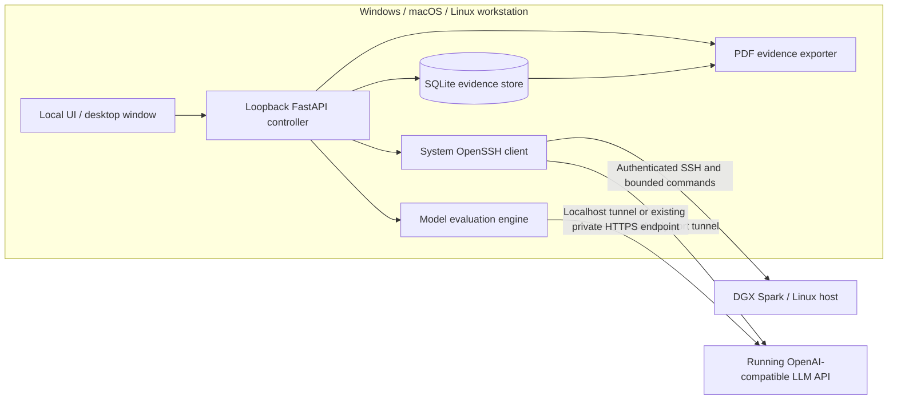

<div align="center">


# SparkCert

### Local-first AI readiness workbench for NVIDIA DGX Spark and SSH-managed Linux systems

**Connect over SSH. Inspect the machine. Evaluate an existing model. Export traceable evidence.**

[](https://github.com/hossain0707/SparkCert/actions/workflows/ci.yml)


**[Download preview builds](https://github.com/hossain0707/SparkCert/releases)** · **[See the workflow](#product-walkthrough)** · **[Read the architecture](#architecture)** · **[Install from source](#run-from-source)** · **[Developer handover](docs/HANDOVER_START_HERE.md)**

</div>

> [!IMPORTANT]
> **v0.2.1 developer preview — unsigned, not an accredited certification.** This independent project is not affiliated with or endorsed by NVIDIA. A passing score covers only the checks that actually ran; it is not a model-safety, regulatory, clinical, or NVIDIA-approved certificate. Installation and real-hardware qualification remain open. See the [release acceptance checklist](docs/RELEASE_CHECKLIST.md).

---

## Download and install

Choose the package matching your computer, **not** the DGX Spark. SparkCert runs on your workstation and connects to the Spark over your network using the existing OpenSSH client.

| Your computer | Download from [Releases](https://github.com/hossain0707/SparkCert/releases) | Installation |
| :--- | :--- | :--- |
| **Windows 10/11 · x64** | `SparkCert-Setup-Windows-x64.exe` | Run per-user setup. Launch **SparkCert** from Start Menu. |
| **Windows · portable** | `SparkCert-Portable-Windows-x64.zip` | Extract **all** files, then run `SparkCert/SparkCert.exe`. |
| **macOS · Apple silicon** | `SparkCert-macOS-Apple-Silicon.dmg` | Open DMG, drag the app into **Applications**. |
| **macOS · Intel** | `SparkCert-macOS-Intel.dmg` | Open DMG, drag the app into **Applications**. |
| **Ubuntu 24.04 · x64** | `SparkCert-Linux-Ubuntu-x64.deb` | Install with Ubuntu Software or `sudo apt install ./SparkCert-Linux-Ubuntu-x64.deb`. |
| **Linux · portable x64** | `SparkCert-Portable-Linux-x64.tar.gz` | Extract the entire folder and launch `SparkCert/SparkCert`. |

**Availability:** the release pipeline uploads these assets to a **pre-release** only after all cross-platform build and packaged-import jobs succeed. If no suitable release appears yet, use the [source installation](#run-from-source) or inspect the [Actions builds](https://github.com/hossain0707/SparkCert/actions/workflows/ci.yml). The project is not silently represented as signed or production-supported.

**System requirements:** SSH client; Windows WebView2 runtime, macOS WebKit, or Linux GTK3/WebKitGTK 4.1; a reachable Linux/DGX Spark SSH host. SSH authentication must already be authorized. No cloud account, subscription or telemetry endpoint is required by SparkCert.

> [!WARNING]
> Public preview packages are **not signed/notarized**. Windows SmartScreen and macOS Gatekeeper may warn or block installation. Do not disable organizational security controls to run an unsigned program. If your security policy disallows unsigned binaries, follow the readable [source installation](docs/INSTALLATION.md) or await a signed release. A SHA-256 checksum is for download integrity, not authenticity.

<details>
<summary><strong>Verify a downloaded file</strong></summary>

Get `SHA256SUMS.txt` from the same GitHub release as the installer.

**Windows (PowerShell)**

```powershell
Get-FileHash .\SparkCert-Setup-Windows-x64.exe -Algorithm SHA256
```

**macOS / Linux (Terminal)**

```bash
shasum -a 256 SparkCert-macOS-Apple-Silicon.dmg  # macOS example
sha256sum SparkCert-Linux-Ubuntu-x64.deb        # Linux example
```

Compare the reported digest with `SHA256SUMS.txt`. You should also confirm that the release belongs to this repository and, for organizational use, obtain an approved signed build.

</details>

## Product walkthrough

<div align="center">


*Illustrative, reduced-motion-aware animation — **not** a real-time GPU capture.*

</div>

**1. Connect.** Import a familiar VS Code Remote-SSH alias from `~/.ssh/config`, or enter a host, port and username manually. The system OpenSSH client manages keys, agents, verified host fingerprints and ProxyJump.

**2. Inspect.** Collect bounded, read-only host diagnostics including OS, GPU, Linux RAM, disk, Python, and Docker. The readiness checklist exposes its exact heuristic thresholds.

**3. Evaluate.** Open a local-only SSH tunnel to an **already-running** OpenAI-compatible model API. Execute deterministic built-in/custom probes with bounded repetition/concurrency and observed response times.

**4. Report.** Keep assessment history in local SQLite, check a stored-result SHA-256 digest, apply retention controls, and export evidence PDFs. There is no remote SparkCert agent in this preview.

## Interface preview

<table>
<tr><th align="left">Desktop workspace</th><th align="left">Responsive layout</th></tr>
<tr>
<td width="68%"></td>
<td width="32%"></td>
</tr>
</table>

> These are UI validation screenshots using **mock data**, not actual Spark benchmark results. The packaged desktop experience still requires clean-machine acceptance testing.

## Architecture

<div align="center">


</div>



**Trust boundaries:** the controller binds to `127.0.0.1` only; non-health API requests require a per-process token; SSH enforces `known_hosts`; model responses can be persisted locally and may contain sensitive information. SparkCert does **not** automatically deploy a model, provision network interfaces, recover unbootable machines, or claim NVIDIA certification.

Deep dives: [Architecture](docs/ARCHITECTURE.md) · [Security model](docs/SECURITY_MODEL.md) · [Interactive architecture explorer](docs/ARCHITECTURE.html) (open locally) · [Design system](docs/DESIGN_SYSTEM.md)

## Capabilities at a glance

| Module | Available in preview | Still to verify or implement |
| :--- | :--- | :--- |
| Connectivity | SSH aliases/keys, Ethernet/LAN/VPN via existing OS routing, system terminal | Zero-config discovery, real multi-OS/DGX acceptance |
| Remote operations | Read-only diagnostics, home-scoped listing, opt-in 16 MiB guarded transfers | Bulk sync, adversarial filesystem/security review |
| Model connectivity | Managed loopback-only tunnel, configurable model API target | Automatic remote model discovery and deployment |
| AI readiness | 7 infrastructure checks, 4 built-in behavioral probes, custom cases, p50/p95 | Validated enterprise policies, RAG/prompt-injection robustness suites |
| Evidence | SQLite history, audit events, digest checks, retention, PDF | Tamper-evident signed chain of custody, encryption at rest |
| Desktop packaging | CI-packaged Windows/macOS/Linux **unsigned previews** | Authenticode, Apple notarization, clean-device QA |
| Security posture | Local bind, per-process token, strict SSH host keys | Independent penetration test and enterprise policy sign-off |

## First connection (about five steps)

1. **Connect your computer and DGX Spark** by direct Ethernet, the same LAN, or a pre-configured trusted VPN. Direct cable may require IP setup.
2. **Verify access in your system terminal** using `ssh user@host` or `ssh my-dgx-spark`. Verify the host fingerprint through a trusted channel; never disable host-key checking.
3. **Launch SparkCert**, go to **Connections**, select **Import SSH config** or add a manual profile.
4. **Run diagnostics** and, if your Spark hosts a compatible model API, start a **Private API tunnel** (for example remote port `8000`, local port auto).
5. **Run an evaluation**, inspect each result and download the PDF evidence report.

```sshconfig
# Example: ~/.ssh/config — replace with your actual account, host and key
Host my-dgx-spark
  HostName 192.168.1.20
  User dgx-user
  IdentityFile ~/.ssh/id_ed25519
  Port 22
```

For troubleshooting authentication, Windows OpenSSH installation, macOS security prompts, Linux GTK packages, private networking and model API configuration, see the [platform-specific installation guide](docs/INSTALLATION.md).

## Run from source

Use this method when preview installers are unavailable or your organization requires inspecting code before execution.

**Requirements:** Python 3.11+, a system OpenSSH client, and an installed web browser.

```bash
git clone https://github.com/hossain0707/SparkCert.git
cd SparkCert
python -m venv .venv
# Activate the environment:
# macOS/Linux: source .venv/bin/activate
# Windows PowerShell: .venv\Scripts\Activate.ps1
python -m pip install -e .
python -m sparkcert
```

This opens a local browser interface at `127.0.0.1:<random-port>`. To use an optional native desktop window, install `pip install -e '.[desktop]'` and run `python -m sparkcert.__main_desktop__`.

To run tests:

```bash
python -m pip install -e '.[dev]'
python -m pytest -q
node --check web/app.js     # optional, requires Node.js
```

## Development and transparent verification

**Code version:** `0.2.1b1` (developer preview). Local baseline: 15 Python automated tests passed; JS parse and offline mock-data UI checks passed. Automated cross-platform package **build/import** checks are configured in [CI](.github/workflows/ci.yml). A successful CI run proves compilation/import on the runner, **not** that an ordinary user has installed the product or that it works against physical DGX Spark hardware.

Release qualification remains explicitly gated on real Windows/macOS/Ubuntu installation, SSH over Ethernet/LAN/VPN, physical Spark inference evaluation, installer signing/notarization, accessibility checks and an independent security review. See [verification](docs/VERIFICATION.md) and the [release checklist](docs/RELEASE_CHECKLIST.md).

### Continue this project from any workspace

Everything important is retained in version-controlled documents. Start with [START_HERE.md](START_HERE.md), then [AGENTS.md](AGENTS.md), [docs/HANDOVER_START_HERE.md](docs/HANDOVER_START_HERE.md) and [docs/WORKSPACE_HANDOFF.md](docs/WORKSPACE_HANDOFF.md), followed by [docs/PROJECT_STATUS.md](docs/PROJECT_STATUS.md). These record architecture, features, decisions, security boundaries, outstanding work and reproducible tests.

## Author and acknowledgements

**Md Najmul Hossain** · [GitHub](https://github.com/hossain0707)

© 2026 Md Najmul Hossain. SparkCert is independently developed and not affiliated with NVIDIA Corporation. NVIDIA and DGX are trademarks of their respective owners. **Source available does not automatically imply an open-source license**; see [LICENSE-NOTICE.md](LICENSE-NOTICE.md). Commercial use and redistribution terms require an explicit license decision.
