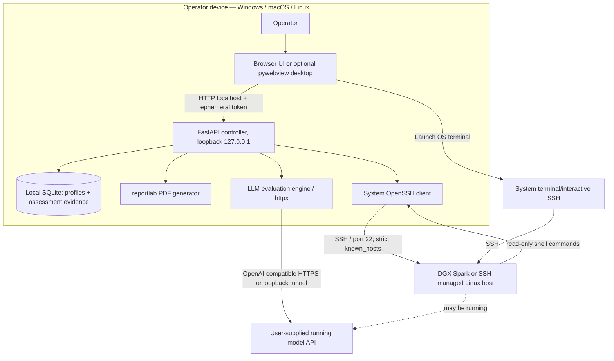
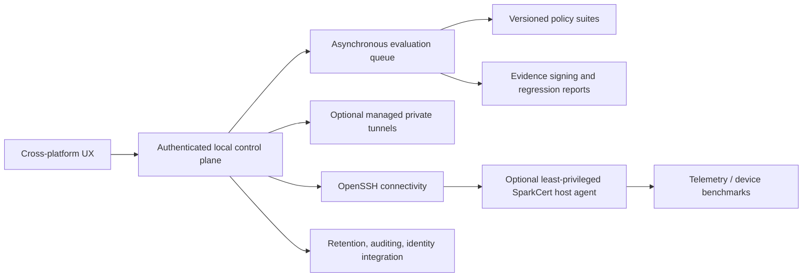

# SparkCert — implemented architecture and evolution plan

**Architecture is documented AS BUILT**, not as an idealized future system. Animated companion: [ARCHITECTURE.html](ARCHITECTURE.html).

## Core system design (v0.1.0)

**Important:** the client does not deploy a SparkCert agent onto the DGX host in v0.1.0. A user's model API must already be available. When private, create an OS-level SSH forward separately. The optional pywebview window serves the same local web app; it is not a Tauri/Electron application.

## Control plane and data plane

| Flow | Data/credential behavior | Trust boundary |
| --- | --- | --- |
| Browser -> localhost FastAPI | Ephemeral token in app HTML/meta and `X-SparkCert-Token` | App listens only on loopback; token bound to launch |
| FastAPI -> local OpenSSH | Host/alias, username, port, optional key *path* | OS `known_hosts`, ssh-agent and user's SSH config |
| SSH -> remote Linux host | Fixed read-only diagnostics, no sudo | Network/host boundary; first-time host fingerprint externally verified |
| UI -> OS terminal -> SSH | Interactive auth in OS terminal | App does not receive raw password |
| Evaluation engine -> configured HTTP endpoint | User prompts and optional bearer key (key not stored) | Endpoint chosen by user; protect private data |
| FastAPI -> local SQLite | Profiles, tests, model output, timestamps | OS filesystem; results NOT encrypted |
| FastAPI -> PDF download | Serialized measured outcomes and caveats | User handles exported sensitive document |

## Source module ownership

| File | Responsibility |
| --- | --- |
| `sparkcert/__main__.py` | Select loopback port, start Uvicorn, open browser |
| `sparkcert/__main_desktop__.py` | Start localhost API and pywebview native window |
| `sparkcert/app.py` | FastAPI routes, validation, origin/token/CSP middleware |
| `sparkcert/ssh.py` | OpenSSH arguments, config aliases, probes, terminal, safe remote directory listing |
| `sparkcert/evaluation.py` | OpenAI-compatible HTTP requests, explicit pass/fail judgments |
| `sparkcert/store.py` | SQLite schema, profile/report CRUD |
| `sparkcert/reports.py` | Escaped ReportLab PDF evidence |
| `web/index.html` | UI shell, icons, navigation |
| `web/app.js` | State, API requests, views, user actions |
| `web/styles.css` | Responsive dark design, motion and reduced-motion support |

## HTTP endpoints implemented

All `/api/*` calls except `/api/health` require the launch token in `X-SparkCert-Token`.

| Verb | Path | Role |
| --- | --- | --- |
| GET | `/` | App HTML/token bootstrap |
| GET | `/api/health` | Local service/version health |
| GET | `/api/overview` | Counts, saved devices, recent runs |
| GET | `/api/ssh/aliases` | Parse local SSH `Host` aliases |
| GET / POST | `/api/devices` | List/create device profiles |
| DELETE | `/api/devices/{id}` | Remove profile; retain run history |
| POST | `/api/devices/{id}/probe` | Read-only SSH diagnostics |
| POST | `/api/devices/{id}/terminal` | Launch local OS terminal/SSH |
| GET | `/api/devices/{id}/files?path=.` | Read-only remote directory listing |
| POST | `/api/devices/{id}/readiness` | Execute seven checks and store report |
| GET | `/api/evaluation/cases` | Four built-in model probes |
| POST | `/api/evaluation/run` | Run live model API tests and store result |
| GET | `/api/reports` | Local run history |
| GET | `/api/reports/{id}` | Details for one run |
| GET | `/api/reports/{id}/pdf` | Download PDF evidence |

## Readiness check rubric (current, not official standards)

Connectivity, Linux OS, NVIDIA GPU visibility in nvidia-smi, >=20% system RAM available, >=15% filesystem storage available, Python 3, Docker accessible. This is a uniform **heuristic** applicable to some workflows, not a mandatory Spark readiness specification. A score is `passed / total`, independent from actual LLM quality.

## Model test rubric (current)

Built-ins: fixed phrase, JSON object key/value, arithmetic, forbidden canary disclosure. Expected response conditions: `exact`, `contains`, `not_contains`, `json_key_value`. HTTP requests specify `temperature:0` and `max_tokens:256`. Errors count as failed cases. No model claim about security or clinical effectiveness is justified by four examples.

## Security and failure pathways

- Strict known-host checking; no auto-accept host keys. New hosts need fingerprint verification outside the app.
- BatchMode for noninteractive probes; password-authenticated shell via native terminal only.
- Validation on names, host/alias and relative remote file listing; no raw user shell commands in diagnostic API.
- Subprocess timeouts, error handling; potential asynchronous UX bottlenecks remain (evaluation runs block the action until completion).
- Origin restriction/CSP/token prevent easy cross-site local actions, but localhost attack surface requires a dedicated review.
- SSH key files, passphrases and user credentials should NEVER be copied into source ZIP or stored in SQLite.
- Evaluation endpoints require user review. They may be remote cloud destinations; 'offline' depends on their placement.
- Stored output may contain sensitive material. Define retention/redaction/encryption strategy before commercial deployment.

## Future architecture, NOT implemented

**Never silently transition** from current architecture to an installed root-level agent, internet-facing service, privileged recovery tool or shared multi-user server. Each requires its own threat model and user consent.

## Platform prerequisites

- Operator Windows/macOS/Linux with Python 3.11+, system OpenSSH, browser (optional pywebview).
- Reachable DGX Spark Linux host with SSH enabled, accepted known-host identity, appropriate user permissions and optionally NVIDIA tooling.
- Existing running OpenAI-compatible inference API reachable directly or through a *manually configured* SSH tunnel.

## Test & packaging architecture

Pytest covers API, SQLite/report/PDF, SSH parsing and mocked probes, and HTTP evaluation with mock transport. GitHub Actions recipes test on Linux then *attempt* native packaging for Windows/macOS/Linux. Success has not been established in this workspace. CI artifacts would still require physical OS/device validation and proper distribution signing.
